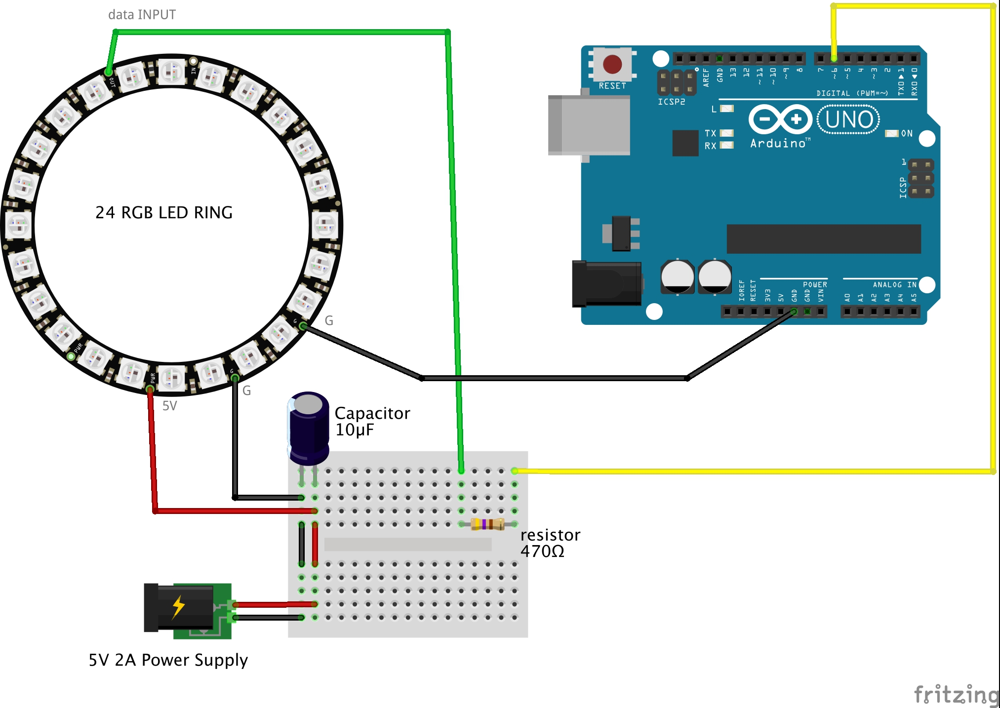

# 24 RGB Ring

This Adafruit NeoPixel ring contains 24 individually addressable RGB LEDs arranged in a closely spaced circle that can all be controlled with a single digital output of a microcontroller. 

Several rings can be chained together, making them great for adding some shine to a small robot or wearable electronics project.

Read more about LED Rings by Adafruit [here](https://www.pololu.com/product/2538)

----
## Features and specifications

- 24 individually addressable RGB LEDs (SK6812- or WS2812B-based NeoPixels)

- Circle outer diameter of 2.6″(66 mm) and inner diameter of 2.05″ (52.5 mm)

- 24-bit color control (8-bit PWM per channel); 16.8 million colors per pixel

- Operating voltage: 5V

- Each RGB LED draws approximately 50mA at 5V with red, green, and blue at full brightness (~1.2 A max for the ring)

- Multiple NeoPixel rings can be chained together, but they will need accordinly powering

Detailed Adafruit NeoPixel Uberguide

----
## HARDWARE

- Arduino Board

- 24 RGB LED Ring

- 5V 2A Power Supply

- 10 μF capacitor

- 470 Ω resistor

----
## WIRING

- The ring has **four connection points.**

- **The pin labeled GND** is the ground pin, and should be connected to the ground pin of the microcontroller that is controlling the LEDs and also to the negative terminal of the power supply.

- **The pin labeled PWR +5V** is the power input pin, and should be connected to a suitable power supply. An input voltage of 5 V is used to power the ring, and each LED on the ring can draw up to 50 mA at 5 V when outputting white at full brightness. That means the ring could draw up to a maximum of around 1.2 A.

- **The pin labeled Data Input** is an input that receives the signal controlling the LEDs. This pin should be connected to a microcontroller output pin.

- **The pin labeled Data Out** is optional. It can be connected to the data input pin of another LED product in order to form a chain.

- **WARNING** NeoPixels can be easily damaged if proper precautions are not taken when using them. We suggest adding a capacitor of at least **10 μF** between the ground and power lines and a **100Ω to 1000Ω resistor** between your microcontroller and the signal input pin.

* Click on image to expand

----
## INSTALLING LIBRARIES

Install the ** Adafruit NeoPixel by Adafruit** by following these steps:

1. At the left side of your Arduino IDE, click on the library icon (looks like a group of books)

2. A new panel will open, this is your Library Manager. At the top there is a search box: type **""Adafruit NeoPixel**

3. Install the option "**Adafruit NeoPixel by Adafruit"**

4. Once installed, you can close your Library Manager by clicking on the "books" icon again.

5. Done! You dont need to repeat this intallation process again.

----
## CODE and INSTRUCTIONS

----
## MORE TUTORIALS

[Ring lamp](https://learn.adafruit.com/neopixel-ring-lamp/overview)
