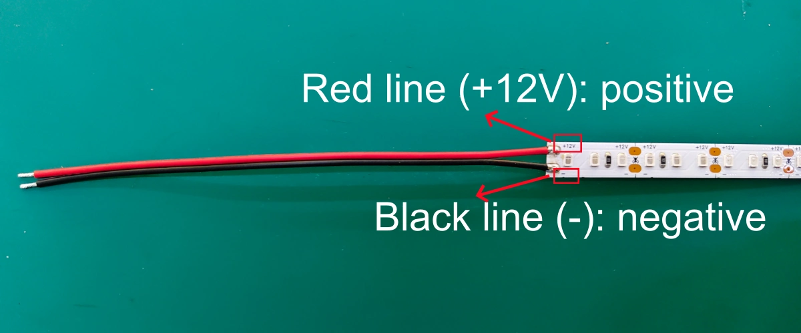
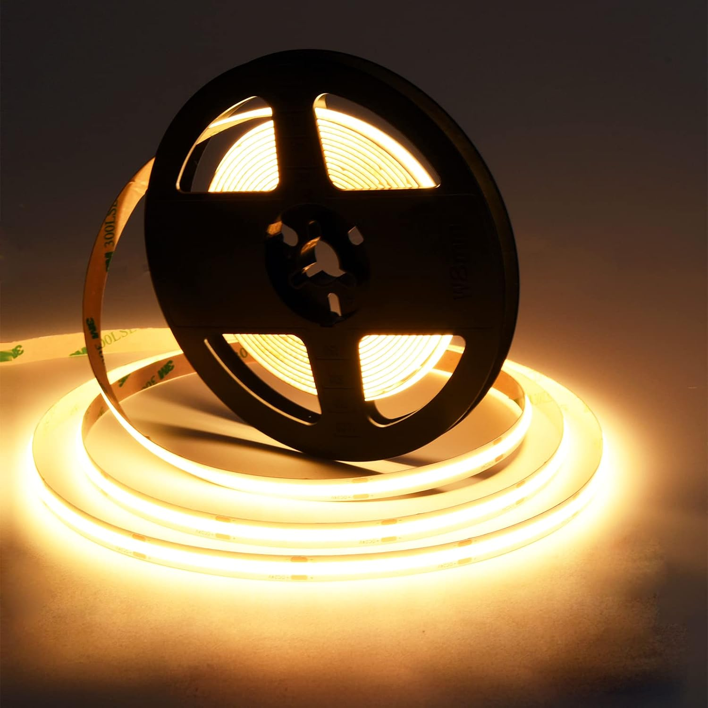
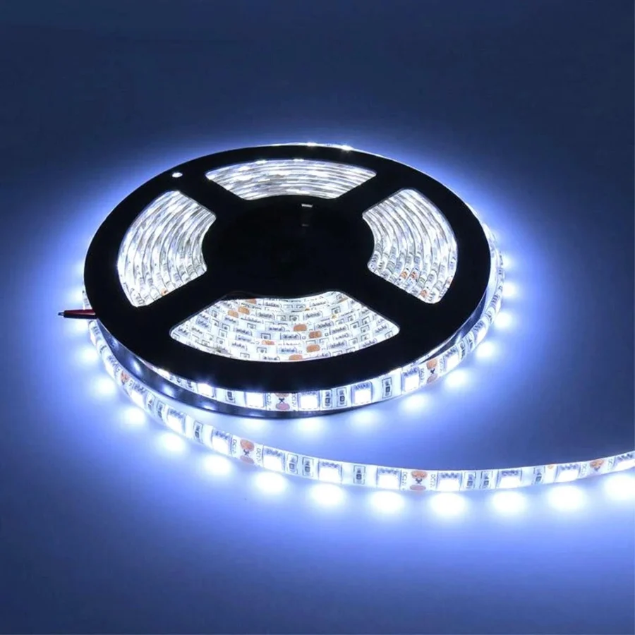
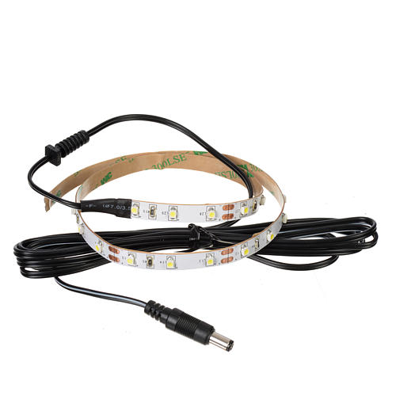
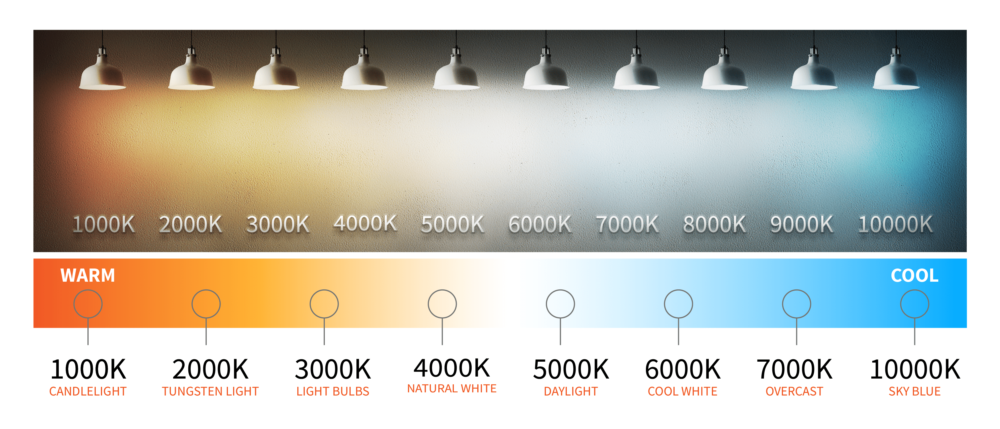

# Non-Addressable LED Strips - Monochrome

A non-addressable strip has only two connections, + and -. All the LEDs light up together, with the same colour and brightness.

This tutorial is suitable for COB and traditional LED strips: 

---
### COB LED strips

Unlike traditional LED strips, COB technology embeds multiple tiny LEDs close together, forming a continuous line of light (no visible dots).​

​Usually high-density, bright, and flexible.

They could be more expensive than traditional LED strips.

---
### hackSpace kits available:

- Cold White, 12V, (39 LEDs), requires 12V 1A Power Supply.

- Warm White, 12V, **(PENDING)**, 

- COB Warm White, 5V, **(PENDING)**, requires 5V 2A Power Supply.

---
### Cutting LED strips

DO NOT cut the LED strips of your hackSpace kits. If you need shorter or larger strips, approach a technician. 

---
### POWERING

Check [this class](https://github.com/kingston-hackSpace/All-about_LEDs/blob/main/Class_LEDstrips.pdf) to understand more about powering

---
### Powering a 12V monochrome non-addressable LED Strip (NO ARDUINO, NO CODING)

Plug the strip from your hackSpace kit to a 12V 1A power supply. Do not use larger strips, they will requiere higher current. 

Suitable for kits:

- Cold White, 12V, (39 LEDs), requires 12V 1A Power Supply.

- Warm White, 12V, **(PENDING)**, 

 

---
### Programming a 5V monochrome non-addressable LED STRIP

**HARDWARE**

- Arduino UNO

- 12V 1A Power Supply

**WHY DO YOU NEED A POWER SUPPLY?**

Even when Arduino pins supply 5V, it can provide only 20mA (current), which is far less than what your strip requires. For this reason you will need an external Power Supply.
Insufficient current may result in overheating and a fire hazard. 

** **

**CODE and INSTRUCTIONS**

---
### About light temperature

