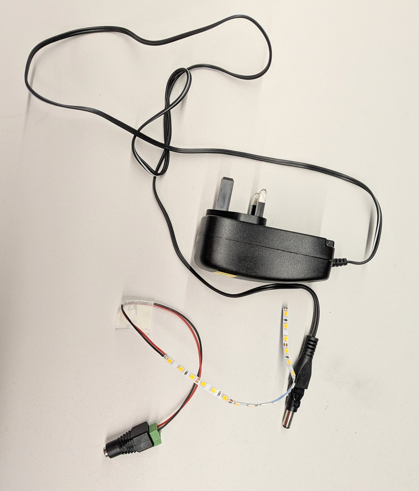

# Non-Addressable LED Strips - Monochrome

A non-addressable strip has only two connections, + and -. All the LEDs light up together, with the same colour and brightness.

This tutorial is suitable for COB and traditional LED strips: 

---
### COB LED strips

Unlike traditional LED strips, COB technology embeds multiple tiny LEDs close together, forming a continuous line of light (no visible dots, see image above).​

​COB are usually high-density, bright, and flexible.

They could be more expensive than traditional LED strips.

---
### LED strip kits available at hackSpace:

*These kits are for learning purposes only*. 

- Cold or Warm White, 12V, requires 12V 1A Power Supply.

- COB Warm White, 5V, **(PENDING)**,

---
### Cutting LED strips

DO NOT cut the LED strips of your hackSpace kits. If you need shorter or larger strips, talk to a technician. 

---
### POWERING

- If you have a 12V strip, you need a 12V Power Supply.

- If you have a 5V strip, you need a 5V Power Supply.

**WHY DO YOU NEED A POWER SUPPLY?**

Even when Arduino pins supply 5V, it can provide only 20mA (current), which is far less than what your strip requires. For this reason you will need an external Power Supply.
Insufficient current may result in overheating and a fire hazard. 

*WARNING!** Current draw may very. Incorrect current could cause overheat and fire. Ask a technician for a safe powering of LED strips. 

Check [this class](https://github.com/kingston-hackSpace/All-about_LEDs/blob/main/Class_LEDstrips.pdf) to learn more about powering LED strips. 

---
# Powering a 12V monochrome non-addressable LED Strip (NO ARDUINO, NO CODING)

Plug your 12V LED strip (from your hackSpace kit) to a 12V 1A power supply. Do not use larger strips, they will requiere higher current. 

 

---
# Programming a 12V monochrome non-addressable LED STRIP

---
## HARDWARE

You will need:

- Power Supply

- Arduino board

- IRLZ44N MOSFET (used to switch high current/voltage from the power supply using a control signal from the Arduino)

- Diode 1N4007 or 1N4001 (protects the circuit from voltage spikes)

- 220ohms resistor (protects the Arduino signal pin)

- 1K resistor (grounds MOSFET's Gate to reduce electrical noise)

- 12V LED strip

---
## DIAGRAM

⚠️ IMPORTANT: MOSFET pins are not interchangeable. 

Follow [this MOSFET diagram BEFORE WIRING](https://github.com/kingston-hackSpace/12V_devices_with_Arduino/blob/main/IRLZ44N.png)

See [wiring diagram here](https://github.com/kingston-hackSpace/12V_devices_with_Arduino/blob/main/12V_device_bb.png)

---
### SAFETY NOTE

⚠️ At 5A, the IRLZ44N will get warm. 

For higher currents (up to 10 A), **you must use a heatsink and allow air flow**.

---
## ABOUT THE IRLZ44N MOSFET

The IRLZ44N MOSFET is the main component that allows us to control a 12 V actuator using a 5 V signal from an Arduino.

The IRLZ44N can be used:

- As an on/off switch

- With PWM signals, for example to control motor speed or LED brightness

---
## CODE and INSTRUCTIONS

- After you have wired your circuit, open Arduino IDE

- Navegate: File > Examples > 1.Basics > Blink

- In the code, programme Pin 10 instead of BUILD_IN

- Upload the code to your Arduino Board
---
### Programming a 5V monochrome non-addressable LED STRIP

CONTENT PENDING

---
### About light temperature

